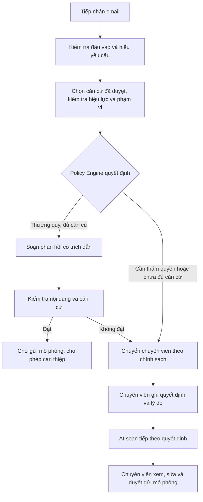

# Exodia · Escalation Referee

**Trợ lý xử lý email sinh viên dựa trên quy định, biết khi nào cần chuyển cho người có thẩm quyền.**

Exodia hỗ trợ văn phòng Công tác Sinh viên tiếp nhận email, hiểu yêu cầu, tìm căn cứ
và chuẩn bị phản hồi. Câu hỏi thường quy được xử lý trong phạm vi chính sách cho phép;
yêu cầu xin ngoại lệ, phê duyệt hồ sơ hoặc chưa đủ căn cứ được chuyển cho chuyên viên.
Mỗi lần xử lý giữ lại nguồn đã dùng, lý do quyết định và lịch sử can thiệp.

Dự án của đội **Exodia**, phát triển cho **Đề A — MLAI Hackathon 2026**.
Tên bài toán và hệ thống trong đặc tả: **Escalation Referee**.

> **Phạm vi bản demo:** dữ liệu email mẫu và quy định seed là giả lập. Hệ thống chưa
> kết nối hộp thư bên ngoài; thao tác gửi email được mô phỏng. LLM có chế độ gọi
> OpenAI thật và chế độ replay offline; kết quả replay không đại diện cho chất lượng LIVE.

## Bài toán Exodia giải quyết

Một email hành chính có thể vừa hỏi thông tin, vừa xin một quyết định mà chỉ cán bộ
có thẩm quyền được đưa ra. Tìm thấy một điều khoản liên quan chưa đủ để tự trả lời:
cần xét hiệu lực văn bản, đối tượng áp dụng, dữ kiện còn thiếu và phạm vi thẩm quyền.

Exodia tập trung vào ba nhóm nghiệp vụ:

| Nhóm | Ví dụ nhu cầu |
|---|---|
| Điểm rèn luyện | Tra cứu quy định, xác định văn bản áp dụng theo khóa và học kỳ |
| Rút học phần | Hỏi điều kiện, thời hạn và quy trình rút học phần |
| Phúc khảo điểm | Hỏi thủ tục, lệ phí; chuyển người xử lý khi xin nộp trễ hoặc ngoại lệ |

Ví dụ: **“Lệ phí phúc khảo một học phần là bao nhiêu?”** có thể được trả lời từ
nguồn đang có hiệu lực. **“Cho em nộp phúc khảo sau hạn”** cần người có thẩm quyền
quyết định, dù hệ thống đã tìm được quy định về thời hạn.

## Cách hệ thống xử lý một email



**LLM trích xuất, chọn căn cứ và diễn đạt; Policy Engine quyết định
`AUTO_REPLY` hay `ESCALATE`.** Việc một nguồn được duyệt không cấp cho AI quyền
phê duyệt hồ sơ cá nhân.

Ba lý do chuyển chuyên viên chính là **cần thẩm quyền**, **ngoài phạm vi/không có
căn cứ an toàn** và **chưa xác định được dữ kiện áp dụng**. Lỗi kỹ thuật được giữ
riêng ở trạng thái `ERROR`, kèm thông tin để xử lý lại.

Sơ đồ trên mô tả luồng nội bộ đầy đủ. Với email mới trong **Judge LIVE**, hệ thống
chỉ tạo kết quả xem trước; phản hồi tự động dừng ở `PREVIEW_READY`, không tạo việc gửi.

## Các chức năng chính

- **Tiếp nhận và xử lý email:** nhập người gửi, tiêu đề, nội dung hoặc chọn thư mẫu;
  phân biệt câu hỏi thông tin với yêu cầu quyết định cho hồ sơ cá nhân.
- **Quy định và căn cứ:** nạp văn bản, giữ bản gốc và cấu trúc điều khoản; quản trị
  viên kiểm tra nguồn, ngày hiệu lực và phạm vi trước khi đưa vào sử dụng.
- **Phản hồi có thể đối chiếu:** bản nháp kèm mã căn cứ; kiểm tra trích dẫn, giá trị
  nêu trong phản hồi và lời cam kết vượt thẩm quyền trước khi cho đi tiếp.
- **Hàng chờ chuyên viên:** trình bày vấn đề, dữ kiện, căn cứ và câu hỏi cần quyết;
  lưu quyết định cùng lý do, hỗ trợ soạn tiếp và duyệt bản phản hồi.
- **Can thiệp vào tự động hóa:** trong chế độ nội bộ, phản hồi tự động có khoảng
  chờ mặc định 60 giây; cho phép hủy gửi, chuyển chuyên viên và tạm dừng tự động.
- **Lưu vết và phục hồi:** SQLite lưu email, kết quả, nguồn sử dụng, công việc nền
  và nhật ký; xử lý lại giữ liên kết với lịch sử trước đó.
- **Kiểm thử và đo lường:** Verify đi qua pipeline dùng chung với ứng dụng;
  có công cụ thu thập kết quả và tài liệu thiết kế đánh giá/nghiên cứu người dùng.

Khả năng thao tác phụ thuộc chế độ chạy. Bản demo hạn chế quyền không mở các chức
năng quản trị, duyệt gửi hoặc hàng chờ đặc quyền cho khách.

## Các chế độ sử dụng

| Chế độ | Mục đích và giới hạn |
|---|---|
| Nội bộ — `APP_MODE=private` | Trải nghiệm luồng đầy đủ: xử lý, quản trị nguồn, chuyên viên, điều khiển gửi mô phỏng và đo lường. Danh tính local phục vụ lưu vết, chưa phải xác thực tài khoản production. |
| Demo — `APP_MODE=restricted_demo`, replay | Chạy các email mẫu được duyệt và Verify4 bằng phản hồi đã ghi. Khóa thao tác đặc quyền; mặc định không cho xử lý email mới. |
| Judge LIVE có kiểm soát | Operator cấp quyền riêng cho từng phiên trình duyệt; có hạn mức, sổ ngân sách và công tắc tắt. Email mới chỉ được xử lý để xem trước, không gửi. |

Hai biến `JUDGE_INPUT_ENABLED` và `JUDGE_LIVE_ENABLED` mặc định bằng `0`.
Việc bật LIVE, cấp quyền phiên hoặc gọi API cần authorization riêng của Project
Coordinator. Mã đối chiếu phiên hiển thị trên UI không phải thông tin cấp quyền.

## Chạy nhanh bản demo offline

Yêu cầu **Python 3.11** theo [`.python-version`](.python-version).
Thực hiện từ thư mục gốc repository.

### 1. Cài môi trường

Windows PowerShell, đã cài Python 3.11 và Windows `py` launcher:

```powershell
powershell -ExecutionPolicy Bypass -File scripts/setup.ps1
.\.venv-bootstrap\Scripts\Activate.ps1
```

Script tạo môi trường `.venv-bootstrap` và cài các phụ thuộc trong
[`requirements.txt`](requirements.txt). Trên Linux/macOS:

```bash
python3.11 -m venv .venv-bootstrap
source .venv-bootstrap/bin/activate
python -m pip install -r requirements.txt
```

### 2. Tạo cấu hình local

Nếu chưa có `.env`, sao chép [`.env.example`](.env.example) thành `.env`.
Giữ cấu hình demo offline dưới đây; không cần API key:

```dotenv
APP_MODE=restricted_demo
LLM_PROVIDER=openai
OPENAI_MODEL=gpt-6-luna
OPENAI_REASONING_EFFORT=none
OPENAI_API_KEY=
LLM_MODE=replay
LLM_CACHE=0
JUDGE_INPUT_ENABLED=0
JUDGE_LIVE_ENABLED=0
JUDGE_LIVE_MODEL=
DATABASE_PATH=data/app.db
```

Trong `.env.example`, `OPENAI_MODEL` để trống; cần điền như trên để khớp cấu hình
replay của dự án. Biến môi trường đã đặt trong terminal được ưu tiên hơn `.env`.
Giữ `.env`, khóa API và cơ sở dữ liệu local ngoài Git.

### 3. Khởi động và khám phá

```powershell
python run_local.py --server.address 127.0.0.1 --server.port 8511
```

Mở [ứng dụng local](http://127.0.0.1:8511), rồi:

1. Vào **Xử lý email**, chọn mẫu **Hỏi lệ phí phúc khảo** và đọc phản hồi cùng căn cứ.
2. Chọn **Xin phúc khảo trễ** để xem trường hợp cần người có thẩm quyền.
3. Xem **Quy định & căn cứ** và **Nhật ký kiểm toán** để đối chiếu nguồn và lịch sử.
4. Vào **Kiểm thử**, chạy bộ 4 ca bắt buộc để quan sát các nhánh quyết định.

Replay sử dụng cassette đã có trong [`tests/cassettes/`](tests/cassettes/).
Đầu vào hoặc cấu hình khác có thể không có cassette phù hợp; hệ thống báo lỗi,
không tự chuyển sang gọi API. Giữ tiến trình chạy để các công việc nền tiếp tục.

Hướng dẫn luồng nội bộ, cấu hình LIVE được cấp phép, sao lưu và xử lý lỗi nằm tại
[`docs/RUNBOOK.md`](docs/RUNBOOK.md). Docker/Compose có các vùng dữ liệu riêng cho
dev, study và demo; xem [runbook Docker](docs/deploy/M6_T02_RUNBOOK.md).

## Kiến trúc và công nghệ

Ứng dụng dùng **Python 3.11**, **Streamlit**, **SQLite**, **OpenAI SDK** và chính sách
**YAML**. Runtime chọn căn cứ từ tập nguồn đã duyệt; repository cũng có thành phần
tìm kiếm BM25/embedding. Không phải mọi yêu cầu đều đi qua tìm kiếm vector.

```text
streamlit_app.py     Điều hướng và giao diện ứng dụng
run_local.py        Khởi động giao diện cùng xử lý nền
pages/              Email, chuyên viên, quy định, audit, kiểm thử, đo lường
core/               Pipeline, policy, kiểm tra nội dung, quyết định và gửi mô phỏng
corpus/             Nạp, tách đoạn, duyệt, quản lý hiệu lực và truy xuất nguồn
infra/              SQLite, audit, LLM, cấu hình và kiểm soát quyền Judge
policies/           Quy tắc quyết định P01–P05
verify/             Các bộ tình huống và harness qua pipeline dùng chung
tests/              Regression và cassette phục vụ replay offline
docs/               Đặc tả vận hành, triển khai, đánh giá và nghiên cứu
reports/            Báo cáo kiểm chứng theo từng checkpoint
```

Worker chạy trong tiến trình ứng dụng; đóng tab không dừng công việc đã lưu.
Nguồn chân lý về hành vi và ranh giới liên module là
[`PROJECT_SPEC.md`](PROJECT_SPEC.md).

## Kết quả đã được ghi nhận

Các số liệu dưới đây được trích từ báo cáo trong repository, **không phải lượt
kiểm thử lại của lần cập nhật README ngày 16/10/2026**. Mỗi báo cáo ghi phiên bản
mã nguồn, điều kiện chạy và giới hạn riêng.

| Phạm vi | Kết quả được báo cáo | Nguồn |
|---|---|---|
| M1 — kiểm chứng LIVE lịch sử | Verify4 **4/4**, Escalation5 **4/5**, Full15 **14/15** nhãn ngữ nghĩa; Full15 không có lỗi kỹ thuật | [Báo cáo M1](reports/sprints/M1_runtime_reliability.md), [evidence bất biến](reports/evidence/m1/README.md) |
| M4 — Set A sau tuning, 15/10/2026 | **18 ca**: 13 có quyết định nghiệp vụ, 5 lỗi kỹ thuật; đúng tuyến **12/13** trên các ca có quyết định, thành công đúng tuyến trên toàn bộ **12/18** | [Kết quả Set A](reports/evaluation/M4_T02_SET_A_RESULTS.md) |
| Judge LIVE — smoke có cấp phép, 16/10/2026 | **1 email giả lập** qua OpenAI thật, kết thúc ở `PREVIEW_READY`, không tạo việc gửi và không gửi email; sau thử nghiệm đã trả về Replay/OFF theo báo cáo | [Báo cáo LIVE smoke](reports/sprints/JUDGE_INPUT_LIVE_SMOKE_20261016.md) |

Set A được báo cáo theo hướng mô tả, chưa có ngưỡng PASS chất lượng; **12/13 không
phải độ chính xác trên toàn bộ 18 ca**. Một ca LIVE smoke chỉ chứng minh đường đi
của ca đó. Kết quả lịch sử không tự xác nhận phiên bản đang triển khai, nghiệm thu
cuối cùng hay mức sẵn sàng vận hành thực tế.

Tài liệu nghiên cứu người dùng được lưu tại
[`docs/studies/m5_t01/`](docs/studies/m5_t01/README.md); việc chuẩn bị protocol và
duyệt Gold không chứng minh nghiên cứu đã chạy hoặc đã đo được lợi ích thực tế.
Thích nghi từ phản hồi chưa được giới thiệu như một tính năng đã nghiệm thu.

## Tài liệu cho người tiếp tục dự án

- [Đặc tả sản phẩm và technical contract](PROJECT_SPEC.md)
- [Vận hành local, kiểm chứng và phục hồi dữ liệu](docs/RUNBOOK.md)
- [Bàn giao cho thành viên](docs/TEAM_HANDOFF.md) và [quy trình phối hợp](docs/TEAM_WORKFLOW.md)
- [Protocol đánh giá](docs/evaluation/M4_T01_PROTOCOL.md) và [chỉ mục báo cáo](reports/README.md)
- [Quy tắc làm việc trong repository](AGENT.md)

Task và acceptance do Project Coordinator quản lý theo Trello hoặc authorization
cardless. [`STATUS.md`](STATUS.md) là checkpoint điều phối ghi ngày 10/10/2026;
khi đọc tiến độ sau mốc này, đối chiếu thêm báo cáo theo ngày và quyết định của
Coordinator.
